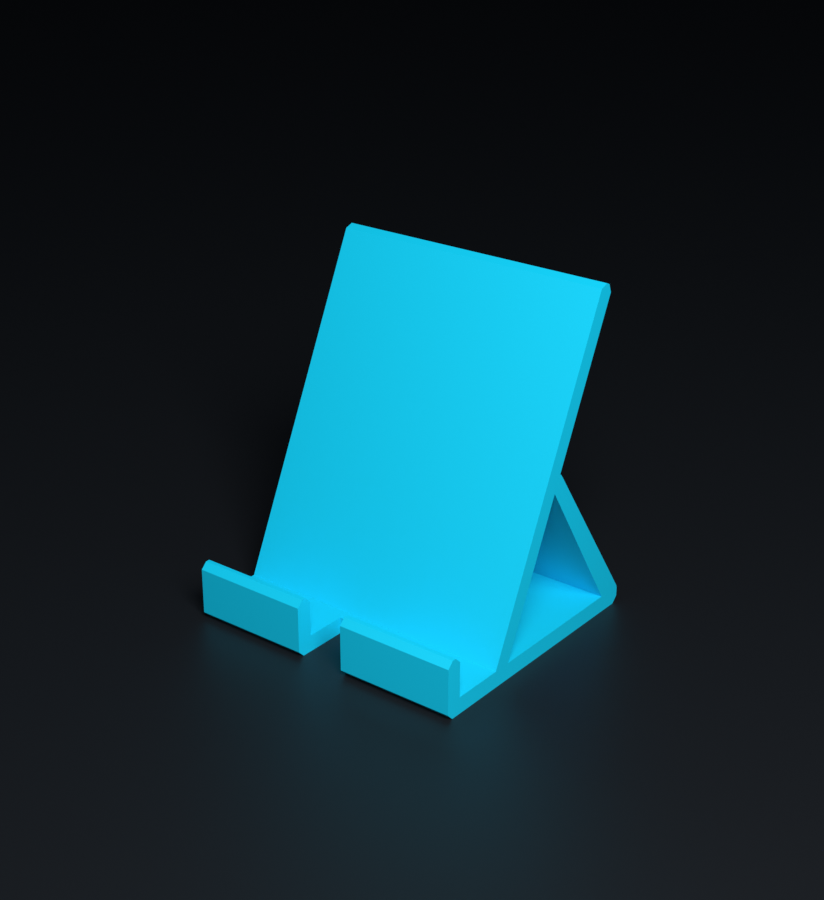

# La misma pieza en Blender: un render presentable, gratis

Importa el mismo `soporte.stl` del video E3 ([`../e3-openscad/`](../e3-openscad/)) en [Blender](https://docs.blender.org/manual/en/latest/getting_started/about/index.html) 5.3.0 (licencia GPL; lo que creas con Blender no queda bajo la GPL; Windows, macOS y Linux, sin cuenta) y genera un render limpio con Cycles desde la terminal, sin abrir la interfaz gráfica y usando el procesador (`CPU`).



## Instalar

Descarga Blender 5.3.0 (descarga directa, sin cuenta): https://download.blender.org/release/Blender5.3/

En Windows puedes instalarlo desde la terminal con:

```bash
winget install --id=BlenderFoundation.Blender -e
```

Si `blender` no queda en el `PATH` del sistema, llámalo con la ruta completa a `blender.exe` dentro de la carpeta donde se instaló o extrajo Blender (por ejemplo `"C:\Program Files\Blender Foundation\Blender 5.3\blender.exe"` o la ruta de tu paquete portátil).

## Usar

Coloca [`render.py`](render.py) y `soporte.stl` (de [`../e3-openscad/`](../e3-openscad/)) en la misma carpeta y ejecuta:

```bash
blender -b -P render.py
```

Esto genera `soporte.png` (824 × 900, 64 muestras en Cycles sobre CPU) e imprime las medidas reales de la pieza (`65.0 x 70.0 x 80.9` mm).

Para renderizar una vuelta completa de 48 cuadros en la carpeta `giro/` (`giro/00.png` a `giro/47.png`, 32 muestras):

```bash
blender -b -P render.py -- giro
```

## Qué hace cada bloque de `render.py`

1. **La pieza (`# 1. La pieza: el STL de E3, en milímetros`):** limpia la escena inicial, importa `soporte.stl` escalado a milímetros (`global_scale=0.001`), imprime sus dimensiones en milímetros y calcula el centro de la caja envolvente para apuntar la luz y la cámara.
2. **Material (`# 2. Material: cian de la marca`):** crea un material `BSDF_PRINCIPLED` con el color cian `#0BC5EA` convertido de sRGB a espacio lineal y rugosidad `0.45`.
3. **Piso y fondo (`# 3. Piso y fondo: grafito`):** agrega un plano de piso y configura el mundo en grafito `#0E1217`.
4. **Luz de área (`# 4. Luz de área`):** crea una luz tipo `AREA` (`energy = 20`, `size = 0.25`) apuntando al centro de la pieza.
5. **Cámara (`# 5. Cámara`):** coloca una cámara con distancia focal `70` mm (`lens = 70`) a distancia `RADIO = 0.354` m y altura `ALTO = 0.16` m, orientada al centro de la pieza.
6. **Render con Cycles (`# 6. Render con Cycles, en el procesador`):** configura `CYCLES` en `CPU` con denoising activado, resolución 824 × 900 y lee los argumentos después de `--` para decidir entre la vista fija (`soporte.png`) o la secuencia de 48 cuadros (`giro/`).

### Cómo cambiar el color, la luz o la cámara

- **Color de la pieza o fondo:** cambia las constantes `CIAN` y `GRAFITO` al inicio del archivo (en formato hexadecimal sRGB).
- **Luz:** ajusta `luz.data.energy` (intensidad) o `luz.data.size` (suavidad de la sombra).
- **Cámara:** cambia `camara.data.lens` (distancia focal en mm), `RADIO` (distancia horizontal al centro en metros) y `ALTO` (altura en metros).

## Programas y sitios

| Recurso | Enlace |
|---|---|
| STL del soporte (video E3) | [`../e3-openscad/`](../e3-openscad/) |
| Blender 5.3 (descargas directas) | https://download.blender.org/release/Blender5.3/ |
| Manual de Blender: línea de comandos | https://docs.blender.org/manual/en/latest/advanced/command_line/arguments.html |
| API de Python: `bpy.ops.wm.stl_import` | https://docs.blender.org/api/current/bpy.ops.wm.html |
| Cycles y render en CPU/GPU | https://docs.blender.org/manual/en/latest/render/cycles/index.html |
| OpenSCAD (CAD paramétrico, GPL v2) | https://openscad.org/about.html |

---
Datos verificados el 17 de noviembre de 2026 en el manual, las notas de versión y el servidor de descargas de Blender, y en la página oficial de OpenSCAD. Ayemi no tiene relación con la Fundación Blender ni con OpenSCAD.  
Código: MIT · Guía: CC BY-SA 4.0 · ¿Tu prototipo necesita su propia placa? Lo construimos: https://ayemi.org/enlaces
