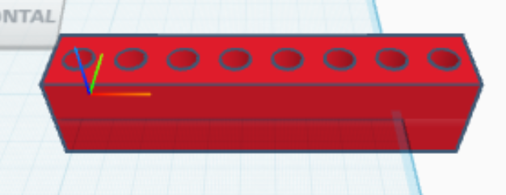

# Diseña una pieza 3D con bloques de código en Tinkercad

Octavo video de la saga **E · Modelado 3D con código** del Laboratorio Ayemi. En [E3](../e3-openscad/) el soporte para
celular era un script de texto en OpenSCAD. Aquí la pieza paramétrica se arma **con bloques**, en el navegador, con
[Tinkercad Codeblocks](https://www.tinkercad.com/codeblocks): un organizador para brocas con **dos variables** (cuántos
huecos y de qué diámetro) y un bloque **Repetir** que coloca cada hueco. Cambias un número, vuelves a ejecutar y la pieza
se rehace sola; luego la exportas en STL.



## Qué necesitas

- Un navegador y una cuenta de Tinkercad (es gratuita; con correo o con una cuenta de Google, Apple, Microsoft o
  Facebook). No se instala nada.
- Para medir el STL: Python 3 y [`medir_stl.py`](medir_stl.py) (no usa bibliotecas externas).

## La pila de bloques

```text
crear variable  huecos      fijar huecos a 6
crear variable  diametro    fijar diametro a 10
crear variable  x           fijar x a 0
repetir (huecos) veces
    caja (sólida)       ancho = diametro + 6   largo = 22   alto = 30
    mover               x = (x)   y = 0   z = 0
    cilindro (hueco)    radio = diametro / 2   alto = 25   lados = 64
    mover               x = (x)   y = 0   z = 10
    cambiar x por (diametro + 6)
crear grupo
```

Cada vuelta del bucle pone una **celda**: una caja sólida y, dentro, un cilindro hueco que sube 10 mm para quedar abierto
por arriba. Las cajas quedan pegadas una tras otra; **crear grupo** las une en una sola pieza y resta los huecos. El paso
a paso, con los nombres de cada bloque, está en [`comandos.md`](comandos.md).

## Medir lo que exportaste

```bash
python medir_stl.py organizador-6.stl organizador-8.stl
```

Imprime el largo, el ancho y el alto (en mm) de la caja que envuelve cada pieza y cuántas caras tiene.

## Programas y sitios

| Recurso | Enlace |
|---|---|
| Tinkercad Codeblocks | https://www.tinkercad.com/codeblocks |
| Ayuda oficial de Codeblocks | https://www.tinkercad.com/help-center/codeblocks |
| Guía oficial de Codeblocks (blog, 25 de marzo de 2022) | https://www.tinkercad.com/blog/official-guide-to-tinkercad-codeblocks |
| Opciones de exportación (blog, 6 de junio de 2022) | https://www.tinkercad.com/blog/tinkertips-export-options |
| Crear una cuenta | https://www.tinkercad.com/help-center/creating-an-account |
| Video anterior de la misma idea, en texto: E3, soporte en OpenSCAD | [`../e3-openscad/`](../e3-openscad/) |
| Video anterior de la saga: E7, un giro de 360° con Blender | [`../e7-blender-giro-360/`](../e7-blender-giro-360/) |

---
Datos verificados el 25 de noviembre de 2026 en tinkercad.com, su centro de ayuda y su blog oficial. Ayemi no tiene
relación con Autodesk ni con Tinkercad.  
Código: MIT · Guía: CC BY-SA 4.0 · ¿Tu prototipo necesita su propia placa? Lo construimos: https://ayemi.org/enlaces
